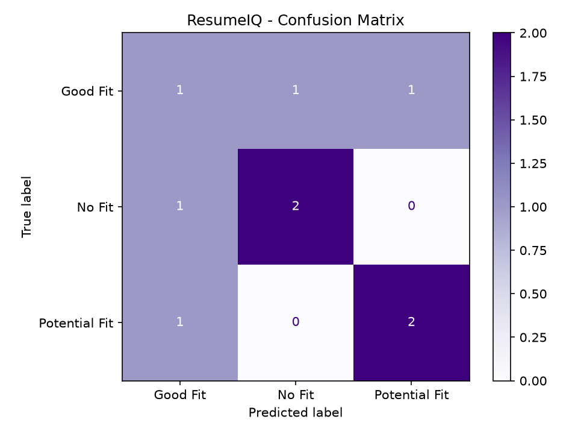

# ResumeIQ – AI-Powered Resume Analyzer

An AI-powered resume analysis platform that evaluates resumes against job descriptions, identifies skill gaps, simulates ATS compatibility, and generates personalized learning roadmaps.

## 🚀 Live Demo

**Try ResumeIQ here:** https://resumeiq-wcwtbjejbwcethudq94dhv.streamlit.app/
## Model Evaluation

ResumeIQ uses a **Logistic Regression classifier with TF-IDF vectorization** to predict resume-job match categories.

### Machine Learning Workflow

ResumeIQ follows a text-based machine learning pipeline:

1. **Data Loading:** Loads resume and job-description examples from the training dataset.
2. **Text Preparation:** Combines resume text and job description text into a single input.
3. **TF-IDF Vectorization:** Converts text into numerical features using unigrams and bigrams.
4. **Data Splitting:** Splits the dataset into 75% training data and 25% testing data using stratified sampling.
5. **Model Training:** Trains a Logistic Regression classifier.
6. **Model Evaluation:** Evaluates predictions using accuracy, precision, recall, F1 score, and a confusion matrix.
7. **Model Saving:** Saves the trained pipeline using Joblib for later predictions.

### Evaluation Metrics

| Metric | Score |
|---|---:|
| Accuracy | 0.56 |
| Precision (Macro) | 0.56 |
| Recall (Macro) | 0.56 |
| F1 Score (Macro) | 0.56 |

### Evaluation Methods

The model is evaluated using:

- Accuracy
- Macro Precision
- Macro Recall
- Macro F1 Score
- Classification Report
- Confusion Matrix

### Confusion Matrix

A confusion matrix is generated during model training and saved at:

`models/confusion_matrix.png`

### Dataset Disclaimer

The current model is trained on illustrative sample data. These evaluation scores are preliminary and should not be interpreted as evidence of real-world hiring accuracy or production-level performance.

Further evaluation on a larger, diverse, real-world dataset is needed to assess generalization.